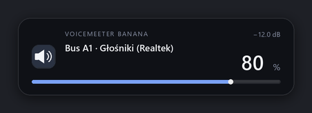
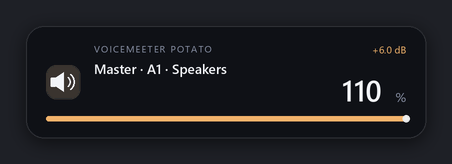
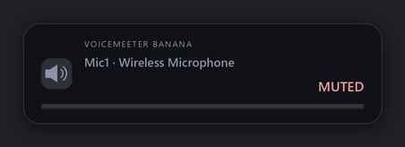
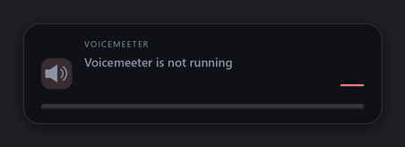
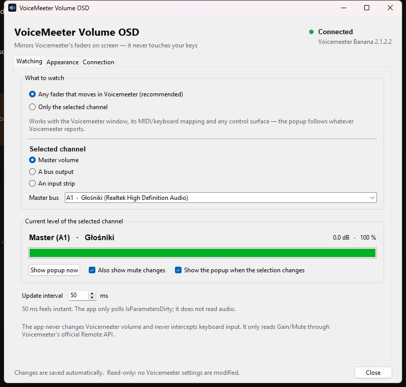
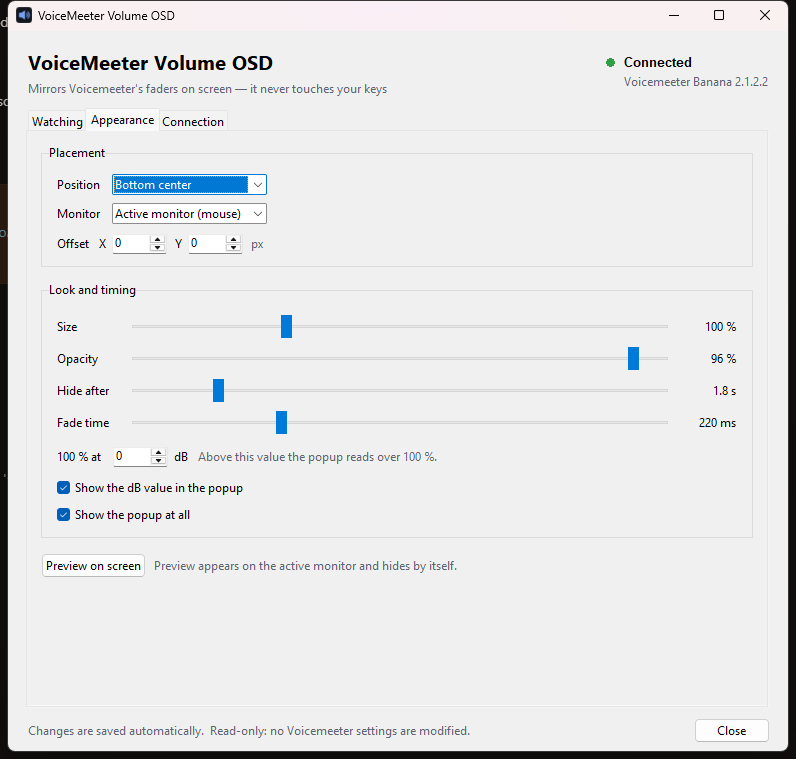

# VoiceMeeter Volume OSD

A small Windows tray app that shows a clean, unobtrusive popup **whenever a
Voicemeeter fader changes** — while you move it in the Voicemeeter window, from
its MIDI/keyboard mapping, or from any control surface.

It is a **pure observer**. It does not hook the keyboard, does not consume the
Windows volume keys, does not change Windows' endpoint volume and **never writes
to Voicemeeter**. It only reads Voicemeeter's parameters through the official
Remote API and draws the result.



| Boost (> 0 dB) | Muted | Voicemeeter away |
|---|---|---|
|  |  |  |

---

## How it works

```
Voicemeeter (GUI + audio engine)
        │  shared-memory Remote API
        ▼
VoicemeeterRemote64.dll
        │  VBVMR_IsParametersDirty / VBVMR_GetParameterFloat
        ▼
monitor thread ──(value changed)──► Tk thread ──► layered OSD window
        │                              │
        └── reconnect loop             └── tray icon + settings
```

* Every 50 ms (configurable) the monitor asks whether parameters changed.
* When they did, it reads the watched `Gain`/`Mute` values and compares them
  with the previous snapshot.
* A change of ≥ 0.05 dB (or a mute toggle) posts one event: the fader that moved
  most wins, so linked faders produce a single, sensible popup.
* Bulk changes (loading a Voicemeeter preset changes many faders at once) are
  used to rebase the snapshot and do not pop up anything.
* The OSD is re-drawn immediately and stays until the hold time elapses, then
  fades out.

The percentage has a configurable **100 % point — 0 dB by default**. The scale
is linear in dB from the bottom of the fader (−60 dB = 0 %) to that reference,
and it keeps going above 100 %:

```
percent = (dB + 60) / (reference + 60) × 100
```

| dB | shown with a 0 dB reference |
|---|---|
| +12.0 | 120 % |
| +6.0 | 110 % |
| **0.0** | **100 %** |
| −6.0 | 90 % |
| −24.0 | 60 % |
| −60.0 | 0 % |

Set **100 % at** to another gain if you prefer (Settings → Appearance, −40…+12 dB,
e.g. −6 dB → 100 % makes 0 dB read 111 %). The exact dB value is always shown;
above the reference the bar, dB text and accent turn amber and the number can
exceed 100 %. Mute changes show `MUTED`.

---

## Requirements

* Windows 10 or 11 (x64 or ARM64; 64-bit Python is the normal choice).
* Voicemeeter, Voicemeeter Banana or Voicemeeter Potato **running**. The Remote
  API is provided by the Voicemeeter GUI application; when the GUI is not
  running there is no data to show.
* Python 3.10+ with tkinter (included in the standard python.org installer).
* Two small packages: `pystray` (tray icon) and `Pillow` (image rendering).

Python and Voicemeeter must have the same bitness: 64-bit Python loads
`VoicemeeterRemote64.dll`; 32-bit Python loads `VoicemeeterRemote.dll`.

---

## Setup and run

```bat
cd C:\path\to\VoiceMeeter_popup
python -m pip install -r requirements.txt
python main.py --settings
```

or double-click **run.bat**. For a windowless launch, **run-hidden.vbs** starts
it minimised in the tray.

The first start opens the settings window. Afterwards the app lives in the
notification area; double-click the tray icon to open settings, right-click for
the menu.

Command line:

| Option | Meaning |
|---|---|
| `--settings` | open settings on start |
| `--minimized` | start in the tray only |
| `--demo` | use the built-in demo backend (no Voicemeeter needed) |
| `--selftest` | run environment/API checks and exit |
| `--preview DIR` | write OSD preview PNGs and exit |
| `--config PATH` | use a specific config file |
| `--verbose` | debug logging |

---

## Using the app



### Watching

* **Any fader that moves** (default) — the popup names whichever strip or bus
  changed, anywhere in Voicemeeter. This is what you want for a knob that
  Voicemeeter itself handles.
* **Only the selected channel** — one target, e.g. `Master (A1)`.
* **Master** is a bus you choose (A1 by default); it is displayed as
  `Master · A1`.
* Mute changes and target changes can be announced too.

Because the app does not touch the keyboard, the volume knob should be made to
control Voicemeeter itself — for example with Voicemeeter's MIDI mapping, its
keyboard shortcuts / MacroButtons, or a control-surface app. The popup then
follows exactly what the mixer does. If the knob still changes Windows' volume,
it is not changing Voicemeeter, and no popup appears (by design).

### Appearance



Nine anchor positions plus X/Y offsets, 60–200 % size, 25–100 % opacity,
0.3–15 s hold time, 0–800 ms fade, active monitor (under the mouse) or primary
monitor, the dB value that reads 100 %, and an optional dB line. Everything
applies immediately.

### Tray menu

Status, Settings, Target submenu (Master + every bus/strip), Show test popup,
Reconnect, Start with Windows, open config/log, Exit.

### Files

| Path | Purpose |
|---|---|
| `%LOCALAPPDATA%\VoiceMeeterPopup\config.json` | settings |
| `%LOCALAPPDATA%\VoiceMeeterPopup\app.log` | rotating log (512 KB × 2) |

Neither needs administrator rights.

---

## The exact Remote API calls

The app binds the functions from `VoicemeeterRemote.h` using `ctypes` and calls
them from a single monitor thread:

| Function | Use |
|---|---|
| `VBVMR_Login` | connect (0 = OK, 1 = OK but Voicemeeter not started) |
| `VBVMR_Logout` | clean disconnect on exit / reconnect |
| `VBVMR_GetVoicemeeterType` | Basic/Banana/Potato, strip and bus counts |
| `VBVMR_GetVoicemeeterVersion` | shown in the settings/status |
| `VBVMR_IsParametersDirty` | every poll: 1 = something changed, −2 = app gone |
| `VBVMR_GetParameterFloat` | read `Gain` and `Mute` |
| `VBVMR_GetParameterStringA` | read `Label` and `device.name` for channel names |
| `VBVMR_RunVoicemeeter` | optional "Launch Voicemeeter" button |

Parameters used:

```
Strip[i].Gain      Strip[i].Mute      Strip[i].Label      Strip[i].device.name
Bus[i].Gain        Bus[i].Mute        Bus[i].Label        Bus[i].device.name
```

Index ranges per edition: Basic 3 strips / 2 buses, Banana 5/5, Potato 8/8
(`Strip[0]…`, `Bus[0]…`). The channel tables come straight from the official
header.

### DLL discovery

1. the path configured in Settings → Connection;
2. `VOICEMEETER_REMOTE_DLL` environment variable;
3. next to the app (`VoicemeeterRemote64.dll`);
4. the uninstall registry entries (`InstallLocation`, `DisplayIcon`);
5. `C:\Program Files\VB\Voicemeeter*` and `C:\Program Files (x86)\VB\Voicemeeter*`;
6. `PATH`.

The settings' connection test prints every path it tried.

---

## Permissions

**None. No administrator rights are required.**

* The Remote API is a normal user-mode DLL loaded into this process; Voicemeeter
  shares its state through a shared-memory pipe. Nothing is injected into
  Voicemeeter and no Voicemeeter file is modified.
* No driver, service or scheduled task is installed.
* "Start with Windows" writes one `REG_SZ` value under
  `HKCU\Software\Microsoft\Windows\CurrentVersion\Run` (per-user, no elevation).
* The OSD is an ordinary layered window; it cannot take focus or block clicks.

If you *don't* grant anything special and the app still refuses to work, the
usual cause is a 32/64-bit mismatch, not permissions.

---

## Build a single executable

```bat
build_exe.bat
```

This installs PyInstaller and produces `dist\VoiceMeeterPopup.exe` (no console).
The exe still needs Voicemeeter installed and running. It is unsigned, so
SmartScreen may warn on first launch.

---

## Troubleshooting

| Symptom | Fix |
|---|---|
| "Voicemeeter Remote API not found" | Check that Voicemeeter is installed; open Settings → Connection and browse to `VoicemeeterRemote64.dll`. |
| "Voicemeeter is not running" | Start the Voicemeeter GUI. The audio engine alone does not expose the Remote API. |
| `ImportError: DLL load failed` | Python and Voicemeeter bitness differ. Use 64-bit Python with 64-bit Voicemeeter. |
| No popup when moving a fader | Open the connection test; confirm reads work. Check that "Show the popup at all" is on and that you are watching the right channel (Any vs selected). |
| The value is one step behind | The Remote API returns cached values for one engine cycle; the app already smooths this. Lower the update interval to 25–35 ms if needed. |
| Nothing in the tray | Settings opens automatically if the tray fails; check `app.log`. |
| Second launch just exits | It asks the first instance to show settings — that is intentional (one instance only). |

---

## Limitations

* Windows only; Voicemeeter only (not Voicemeeter Mac/ARM builds without the
  same DLL).
* The popup shows **gain**, not an audio meter. It does not read peak levels.
* Channel labels and device names come from Voicemeeter as 8-bit ANSI strings;
  unusual characters may be replaced depending on the system code page.
* Only four Remote API clients can be connected to Voicemeeter at once. If other
  tools use the API, `Login` may fail; the app retries and reports it.
* Load-time latency is about one poll interval (default 50 ms).
* The app cannot create Voicemeeter faders that do not exist in the running
  edition.
* It intentionally has no write path, so it cannot control volume itself.

---

## Tests

```bat
python -m unittest discover -s tests -v
python main.py --selftest
```

`--selftest` checks the config, the OSD renderer, the full polling pipeline
against the demo backend, and — when Voicemeeter is installed — the real DLL,
login, channel enumeration and read access. See
[docs/TEST_PLAN.md](docs/TEST_PLAN.md) for the manual test plan.

---

## Project layout

```
main.py                 launcher
run.bat / run-hidden.vbs
build_exe.bat
app/
  cli.py                CLI, logging, selftest, diagnostics
  config.py             validated JSON settings (atomic writes)
  vmapi.py              ctypes binding + DLL discovery
  backend.py            real/mock read-only clients, channel model
  controller.py         polling thread, change detection, reconnect
  levels.py             dB <-> fader-percent helpers
  osd.py                renderer + layered window + animation
  tray.py               pystray icon and menu
  settings_ui.py        tkinter settings window
  startup.py            HKCU Run autostart
  winapi.py             DPI, monitors, single instance, message box
tests/                  unittest suite (no Voicemeeter needed)
tools/make_icon.py      regenerate assets/icon.ico
docs/ARCHITECTURE.md    design notes and trade-offs
docs/TEST_PLAN.md       automated + manual test plan
```

Licence: MIT (see `LICENSE`). Voicemeeter itself is donationware by VB-Audio;
this project only uses its published Remote API.
